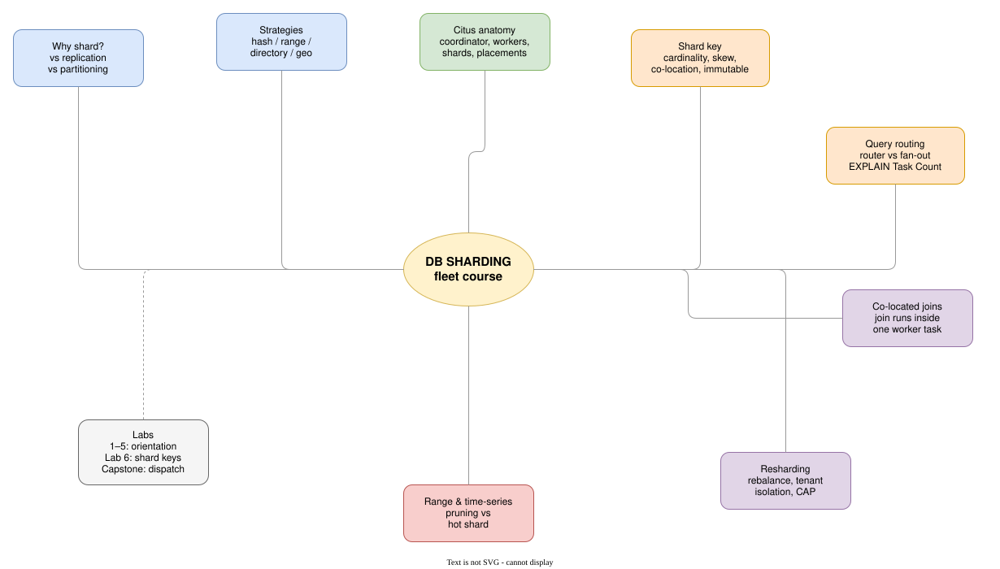

# Database Sharding — A Hands-On Course

Learn database sharding by *doing* it: a real 3-node **Citus** cluster in Docker,
a seeded e-commerce marketplace database (**bazaar**), theory modules with
draw.io diagrams, and guided labs that make you prove every claim against the
live cluster.

## Documentation site

Read this course as a searchable MkDocs Material site with light and dark themes.
Requires [uv](https://docs.astral.sh/uv/).

```bash
uv sync --locked
uv run mkdocs serve
```

Open the local address printed by MkDocs. To build the static site into `site/`:

```bash
uv run mkdocs build --strict
```

The site reads the modules, labs, solutions, and diagrams directly from their
directories under `docs/`; there is no separate copy of the course to maintain.
Run all shell commands on this page from the repository root.

## The story

Bazaar is a marketplace: sellers post listings, buyers favorite them. It
outgrew one Postgres server — so we shard it. Every concept is taught against
this schema:

| Table | One row per | Shard story |
| --- | --- | --- |
| `sellers` | seller profile | distributed by `seller_id` (you do it — Lab 3) |
| `listings` | product listing | shard key experiments (Lab 6) |
| `favorites` | buyer favorite | co-location with sellers (Lab 6) |
| `sellers_by_country` | seller + country | pre-distributed by `country` — the skew demo |
| `order_events` | order event | range partitioning (Lab 6, Task 8) |

## Quick start

```bash
./scripts/bootstrap.sh                      # build + seed + register workers
psql -h localhost -p 5432 -U postgres -d bazaar   # connect (no password)
```

Requires Docker Desktop; no local `psql`? Use
`docker exec -it bazaar-coordinator psql -U postgres -d bazaar`.
Full setup guide: [modules/00-environment-setup.md](modules/00-environment-setup.md).
Rebuild from scratch anytime: `./scripts/reset.sh`.

> The `trust` auth method and no-password setup are for this local lab only —
> never for a real deployment.

## Syllabus

### Modules (theory)

Start with [Module 00 · Environment setup](modules/00-environment-setup.md) —
Docker, compose, and connecting to the cluster.

#### Sharding

| # | Module | You'll learn |
| --- | --- | --- |
| 01 | [Why sharding?](modules/01-why-sharding.md) | vs replication & partitioning, costs, when not to |
| 02 | [Sharding strategies](modules/02-sharding-strategies.md) | hash, range, directory, geo; cardinality; hotspots |
| 03 | [Citus architecture](modules/03-citus-architecture.md) | coordinator/workers, shards, placements, metadata |
| 04 | [Choosing a shard key](modules/04-choosing-a-shard-key.md) | the 5 criteria, PK rule, immutability, shard count |
| 05 | [Query routing](modules/05-query-routing.md) | router vs scatter-gather, EXPLAIN, 2PC |
| 06 | [Resharding & limits](modules/06-resharding-and-limits.md) | rebalancing, tenant isolation, CAP |

#### Partitioning

| # | Module | You'll learn |
| --- | --- | --- |
| 07 | [Partitioning & time-series](modules/07-range-and-timeseries.md) | native partitions vs shards, pruning, bounds, retention |

Finish with [Module 08 · Capstone](modules/08-capstone.md) — design the orders
workload yourself.

### Labs (hands-on — do them in order)

#### Sharding

| Lab | Covers |
| --- | --- |
| [Lab 1](labs/lab-01-orientation.md) | Citus version, active workers |
| [Lab 2](labs/lab-02-table-storage.md) | local vs distributed vs reference tables |
| [Lab 3](labs/lab-03-distribute-sellers.md) | `create_distributed_table`, rows preserved |
| [Lab 4](labs/lab-04-shard-placement.md) | shards vs placements, metadata |
| [Lab 5](labs/lab-05-inside-a-shard.md) | per-shard row counts, deterministic routing |
| [Lab 6](labs/lab-06-shard-key-lab.md) (Tasks 1–7) | **the big one**: hash placement, skew, query routing under two shard keys, co-located joins, shard-key immutability |

#### Partitioning

| Lab | Covers |
| --- | --- |
| [Lab 6](labs/lab-06-shard-key-lab.md) (Tasks 8–9) | range partitions, partition pruning, retention, strategy selection |

Answer keys live in [solutions](solutions/index.md) — try the tasks first.

## Diagrams



The relevant course pages embed scalable diagrams. On the documentation site,
click any diagram to enlarge it in a lightbox without leaving the page; press
Escape or use the close button to return. The existing text illustrations
remain available alongside the images.

## Repo layout

```text
docker-compose.yml        Citus 12.1: coordinator + worker1 + worker2
db/coordinator-init/      schema + seed (runs on first boot)
db/worker-init/           CREATE EXTENSION citus
scripts/bootstrap.sh      up + register workers + pre-distribute one table
scripts/reset.sh          down -v + bootstrap
docs/index.md             course overview and syllabus
docs/modules/             theory (00–08)
docs/labs/                guided exercises
docs/solutions/           expected queries + real output
docs/diagrams/            SVG images and .drawio sources
```

## Concepts covered

Sharding vs replication vs partitioning · hash / range / directory strategies ·
consistent hashing · shard-key selection (cardinality, uniformity, query
alignment, co-location, immutability) · Citus coordinator/worker model ·
distributed / reference / local tables · shards & placements · metadata
catalogues (`citus_tables`, `citus_shards`, `pg_dist_*`) · router vs
scatter-gather queries · co-located joins · distributed transactions & 2PC ·
rebalancing vs resharding · tenant isolation · CAP trade-offs · range
partitioning, pruning & the hot-shard problem · when **not** to shard.
