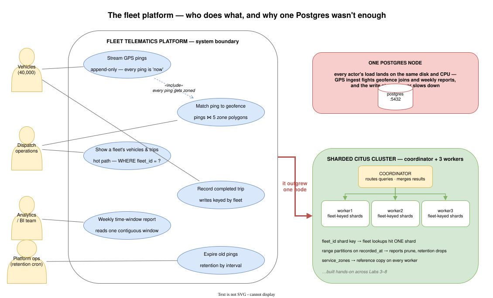

# Database Sharding — A Hands-On Course

Learn database sharding by *doing* it: a real 4-node **Citus** cluster in Docker,
a seeded fleet telematics and geofencing database (**fleet**, with PostGIS),
theory modules and guided labs that make you prove every
claim against the live cluster.

## The story

A ride-hailing and delivery platform tracks tens of thousands of vehicles.
Every vehicle streams GPS pings; geofences decide pricing and dispatch; trips
and fleets anchor the business. It outgrew one Postgres server — so we shard it.



Every concept is taught against this schema:

| Table | One row per | Shard story |
| --- | --- | --- |
| `fleets` | fleet operator | distributed by `fleet_id` (you do it — Lab 3) |
| `vehicles` | vehicle + last GPS fix | shard key experiments (Lab 6) |
| `trips` | completed trip | co-location with fleets (Lab 6) |
| `vehicles_by_region` | vehicle + region | you distribute it by `region` — the skew demo (Lab 6) |
| `vehicle_telematics` | GPS ping | range partitioning (Lab 7), distributed partitioning (Lab 8) |
| `service_zones` | geofence polygon | reference table (Lab 8) |

## Quick start

```bash
./scripts/bootstrap.sh                      # build + seed + register workers
psql -h localhost -p 5432 -U postgres -d fleet    # connect (no password)
./scripts/teardown.sh                       # stop the cluster when done
```

Requires Docker Desktop; no local `psql`? Use
`docker exec -it fleet-coordinator psql -U postgres -d fleet`.
Full setup guide: [modules/00-environment-setup.md](modules/00-environment-setup.md).
Rebuild from scratch anytime: `./scripts/reset.sh`.

> The `trust` auth method and no-password setup are for this local lab only —
> never for a real deployment.

## Concepts covered

- Sharding vs replication vs partitioning
- hash / range / directory strategies
- consistent hashing
- shard-key selection (cardinality, uniformity, query alignment, co-location, immutability)
- Citus coordinator/worker model
- distributed / reference / local tables
- shards & placements
- metadata catalogues (`citus_tables`, `citus_shards`, `pg_dist_*`)
- router vs scatter-gather queries
- co-located joins
- distributed transactions & 2PC
- rebalancing vs resharding
- tenant isolation
- CAP trade-offs
- range partitioning, pruning & the hot-shard problem
- distributed partitioned tables (sharding × partitioning on one table)
- geospatial indexes inside shards (PostGIS GiST)
- reference-table geofence joins
- instant retention via partition drops
- when **not** to shard.

## Documentation site

Read this course as a searchable MkDocs Material site with light and dark themes.
Requires [uv](https://docs.astral.sh/uv/).

```bash
uv sync --locked
uv run mkdocs serve
```

Open the local address printed by MkDocs. To build the static site into `site/`:

```bash
uv run mkdocs build --strict
```

The site reads the modules, labs, solutions, and diagrams directly from their
directories under `docs/`; there is no separate copy of the course to maintain.
Run all shell commands on this page from the repository root.
