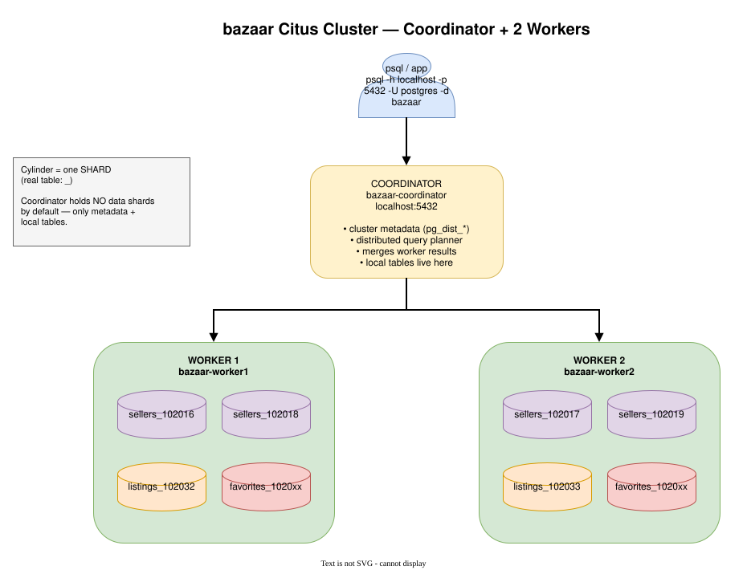
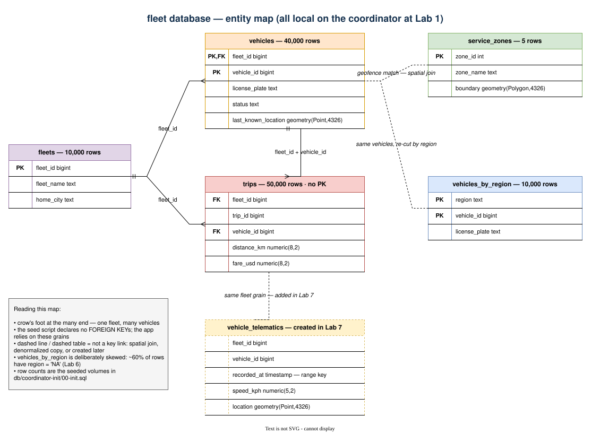

# Lab 1 — Orientation: Meet the Cluster

**Module reference:** [Module 01 — Why Sharding?](../modules/01-why-sharding.md) ·
[Module 03 — Citus Architecture](../modules/03-citus-architecture.md)

## Goal

Get connected to the cluster and learn the two facts every sharded system starts
with: *what software am I running?* and *how many nodes do I have?*

## Terms you will encounter

```text
                 psql
                   |
                   |  You connect here
                   v
        +---------------------+
        |     COORDINATOR     |
        |   localhost:5432    |
        +----------+----------+
                   |
                   v
        +---------------------+
        |   WORKER NODE(S)    |
        +---------------------+
```



| Term | Meaning |
| --- | --- |
| Coordinator | The Citus node you connect to. Applications send queries to the coordinator, which forwards them to the appropriate workers and merges the results. |
| Worker | A node that stores shards and executes the queries the coordinator delegates to it — one worker per shard, or many in parallel. |
| Distributed table | A table that looks ordinary to SQL, but whose rows live in shards spread across the workers. |
| Shard | One slice of a distributed table, stored on a worker. |
| Distribution column | The column Citus uses to decide which shard a row belongs to. The same value always maps to the same shard. Also called the *shard key*. |
| Shard placement | The assignment of a shard to the worker that stores it. |

## The dataset

Every lab runs against the same seeded `fleet` database — a ride-hailing
platform's schema. Nothing here is distributed yet; distributing it is the
work of the later labs.



Two details worth noticing before you connect: the seed script
(`db/coordinator-init/00-init.sql`) declares **no foreign keys**, so the joins
above are the grain the application relies on — not constraints the database
enforces. And `trips` has no primary key at all.

## Connect

Start the lab cluster:

- No password — this is a local, throwaway lab cluster

```bash
./scripts/reset.sh

psql -h localhost -p 5432 -U postgres -d fleet
# or
docker exec -it fleet-coordinator psql -U postgres -d fleet
```

## Task 1.1 — Check the installed extensions

Determine whether the Citus extension is installed in the `fleet` database and
identify its version. While you're there: this cluster also carries a second
extension. Which one, and what is it for?

**Question:** What are the versions of the Citus and PostGIS extensions
installed in `fleet`?

??? hint "Answer"
    Citus is a PostgreSQL extension.
    PostgreSQL tracks installed extensions in `pg_extension` (columns: `extname`, `extversion`).

    You can also see them with the `\dx` meta-command.

## Task 1.2 — Count the active workers

The coordinator keeps a registry of every worker node in the cluster. Find out
how many worker nodes are **active** — registered *and* reachable.

**Question:** How many active worker nodes does the coordinator report?

??? hint "Answer"

    Citus ships a helper function `citus_get_active_worker_nodes()` that returns
    one row per active worker (`node_name`, `node_port`).

    The raw metadata lives in`pg_dist_node` if you want to look deeper.

## Checkpoint

Before moving on, be able to answer:

- [ ] What is the coordinator's job when a query arrives?
- [ ] Which two pieces of metadata did you just query (extension registry and node registry)?

**Next:** [Lab 2 — How is the `fleets` table stored?](lab-02-table-storage.md)

*Stuck? Compare your queries with [solutions/lab-01-solutions.md](solutions/lab-01-solutions.md).*
