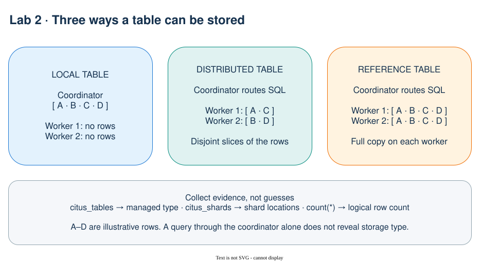

# Lab 2 — Investigate How the `sellers` Table Is Stored

**Module reference:** [Module 03 — Citus Architecture](../modules/03-citus-architecture.md)

## Goal

The `bazaar` database contains a `sellers` table — one row per seller profile
(10,000 sellers; seller 1 is *Leather Lane*, 2 is *Copper Kettle*, 3 is
*Maple & Pine*). Before changing anything, work out **how the cluster currently
manages this table**. Collect three pieces of evidence:

1. Does Citus recognise `sellers` as one of the tables it manages, and if so of
   what type?
2. Do any shards exist for `sellers`, and on which worker nodes do they live?
3. How many rows does `sellers` return when you query it through the
   coordinator?

## Background

A table in a Citus cluster can be in one of three states:

| State | Meaning |
|---|---|
| **Local** | An ordinary PostgreSQL table living only on the coordinator. Citus doesn't manage it. |
| **Distributed** | Sliced into shards; rows spread across workers by the distribution column. |
| **Reference** | Copied in full to *every* worker (used for small lookup/dimension tables). |

The catalogue view `citus_tables` lists everything Citus manages. The view
`citus_shards` lists every shard of those tables and where each is placed.

### Visual guide — locate the rows



The letters represent illustrative rows, not your query results. Compare the
three storage patterns with the metadata you collect below.

## Connect

```
psql -h localhost -p 5432 -U postgres -d bazaar
```

## Step 1 — Is `sellers` a Citus-managed table?

Query `citus_tables` for `sellers`:

```sql
SELECT table_name, citus_table_type, distribution_column, shard_count
FROM citus_tables
WHERE table_name = 'sellers'::regclass;
```

## Step 2 — Do shards exist for `sellers`?

Query `citus_shards` for `sellers` and note the worker each shard is on:

```sql
SELECT table_name, shardid, shard_name, nodename, nodeport
FROM citus_shards
WHERE table_name = 'sellers'::regclass;
```

## Step 3 — How many rows?

```sql
SELECT count(*) FROM sellers;
```

## Question

Based on the three pieces of evidence, how is the `sellers` table currently
stored — local, distributed, or reference? Justify your answer from what you
observed.

## Checkpoint

- [ ] You can name the catalogue views that answer "is this table distributed?"
      and "where are its shards?".
- [ ] You noticed that a **local** table still returns all its rows through the
      coordinator — "not managed by Citus" does not mean "empty".

**Next:** [Lab 3 — Distribute the `sellers` table](lab-03-distribute-sellers.md)

*Stuck? See [solutions/lab-02-solutions.md](../solutions/lab-02-solutions.md).*
