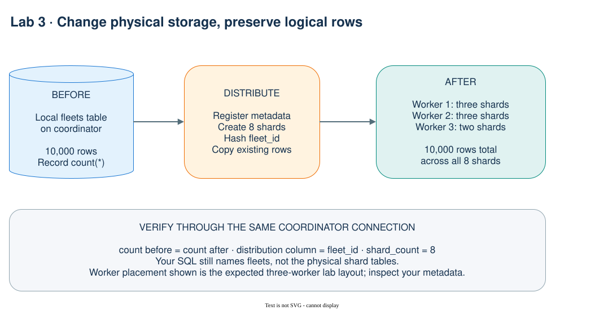

# Lab 3 — Distribute the `fleets` Table

**Module reference:** [Module 03 — Citus Architecture](../modules/03-citus-architecture.md) ·
[Module 04 — Choosing a Shard Key](../modules/04-choosing-a-shard-key.md)

## Goal

Turn `fleets` into a distributed table with exactly this configuration:

| Setting | Required value |
| --- | --- |
| Table | `fleets` |
| Distribution column | `fleet_id` |
| Number of shards | 8 |
| Existing rows | Must remain readable |

## Background

`create_distributed_table('table', 'column', shard_count := N)` does three
things: it registers the table as distributed, creates N empty shards on the
workers, and **moves the existing rows into the shards for you**. The table's
data stays readable throughout.

If you distribute a table with the wrong settings, undo it with:

```sql
SELECT undistribute_table('users');  -- adapt to your table
```

### Visual guide — before and after distribution



Track two things separately: the physical storage changes, but the logical
table name and its total row count stay the same.

## Connect

```bash
psql -h localhost -p 5432 -U postgres -d fleet
```

## Step 1 — Record the row count *before*
Write the number down — you will compare it afterwards.

```sql
SELECT count(*) FROM fleets;
```


## Step 2 — Distribute the table

Create the distributed table with the settings above.

??? hint
      ```sql
      SELECT create_distributed_table('fleets', 'fleet_id', shard_count := 8);
      ```

      Watch the NOTICE output — Citus tells you it's copying the local data into
      shards.

## Step 3 — Verify

1. `citus_tables` lists `fleets` as `distributed`, distribution column
   `fleet_id`, `shard_count = 8`.
2. `SELECT count(*) FROM fleets;` returns the same number as in Step 1.
3. Spot-check a couple of rows: `SELECT * FROM fleets WHERE fleet_id = 1;`

## Checkpoint — all must hold

- [ ] `fleets` is a distributed table.
- [ ] It is distributed by `fleet_id`.
- [ ] It has exactly 8 shards.
- [ ] All original rows (fleet_id 1 to 10000) are still readable through the
      coordinator.

**Next:** [Lab 4 — Shard placement](lab-04-shard-placement.md)

*Stuck? See [solutions/lab-03-solutions.md](solutions/lab-03-solutions.md).*
