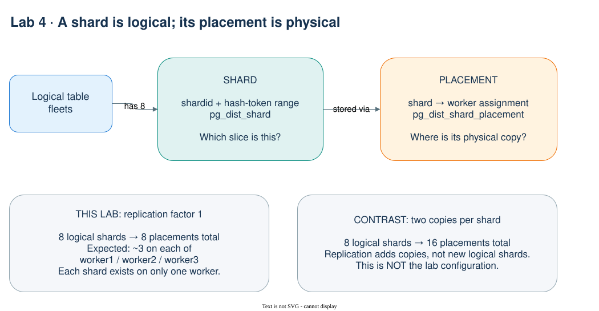

# Lab 4 — Investigate Shard Placement

**Module reference:** [Module 03 — Citus Architecture](../modules/03-citus-architecture.md)

## Goal

`sellers` is now distributed into 8 shards. Investigate **where those shards
live** across the cluster:

1. How many shards does `sellers` have in total?
2. How many shard *placements* does each worker node hold?
3. Is any shard placed on more than one node?

## Background

A **shard** is the logical slice; a **placement** is a physical copy of that
shard on a node. With the default replication factor of 1, each shard has
exactly one placement, spread roughly evenly across the workers.

Metadata you can use:

- `citus_shards` — friendly view: table, shard id, shard name, node, size.
- `pg_dist_shard` — one row per shard (the hash-token range it owns).
- `pg_dist_shard_placement` — one row per placement (shard id → node).
- `pg_dist_node` — the cluster's nodes.

### Visual guide — shard versus placement



Follow a shard ID from its hash-token range to its worker assignment. Count
logical slices separately from copies, then confirm the actual layout with SQL.

## Connect

```
psql -h localhost -p 5432 -U postgres -d bazaar
```

## Step 1 — Count the shards

```sql
SELECT count(*) FROM citus_shards WHERE table_name = 'sellers'::regclass;
```

## Step 2 — Placements per worker

```sql
SELECT nodename, count(*) AS placements
FROM citus_shards
WHERE table_name = 'sellers'::regclass
GROUP BY nodename
ORDER BY nodename;
```

(Include `sellers_by_country` too if you want the full picture — drop the
WHERE clause and group by `table_name, nodename`.)

## Step 3 — Any shard on more than one node?

```sql
SELECT shardid, count(*) AS placements
FROM citus_shards
WHERE table_name = 'sellers'::regclass
GROUP BY shardid
HAVING count(*) > 1;
```

## Question

Which statement accurately describes the shard metadata for `sellers`?

a) 8 shards, all on one worker, each shard placed once
b) 8 shards, split roughly evenly across the workers, each shard placed once
c) 8 shards, each placed on both workers (replicated)
d) 10,000 shards — one per seller

## Checkpoint

- [ ] You can explain the difference between a shard and a shard placement.
- [ ] You found which catalogue shows the hash-token range each shard owns.

**Next:** [Lab 5 — Inside a shard](lab-05-inside-a-shard.md)

*Stuck? See [solutions/lab-04-solutions.md](../solutions/lab-04-solutions.md).*
