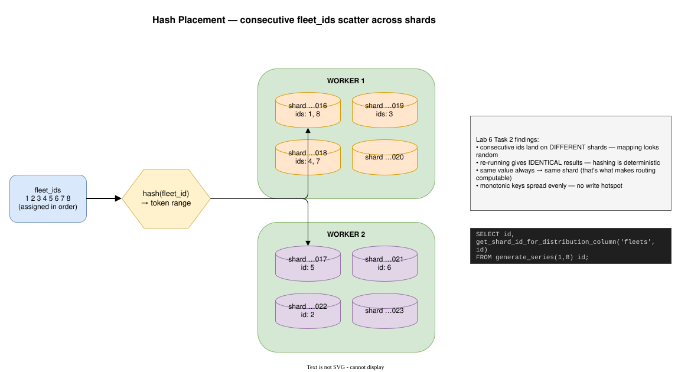

# Lab 5 — Investigate What Each Shard Contains

**Module reference:** [Module 02 — Sharding Strategies](../modules/02-sharding-strategies.md) ·
[Module 03 — Citus Architecture](../modules/03-citus-architecture.md)

## Goal

Look **inside** the shards of `fleets` and make two observations:

1. How many rows does each shard hold — and does the sum equal the row count
   you get through the coordinator?
2. How many shards contain *Metro Cabs* (`fleet_id = 1`)?

## Background

Each shard is a real PostgreSQL table on a worker, named `<table>_<shardid>`
(e.g. `fleets_102008`). The coordinator can query shards directly with the
`run_command_on_shards` function — or you can connect to a worker and query the
shard table yourself.

To find which shard *would* own a value without reading any data, Citus
provides:

```sql
SELECT get_shard_id_for_distribution_column('fleets', 1);
```

## Connect

```bash
psql -h localhost -p 5432 -U postgres -d fleet
```

## Step 1 — Rows per shard

Get the row count and size of each `fleets` shard. One way:

```sql
SELECT shard_name, nodename, shard_size
FROM citus_shards
WHERE table_name = 'fleets'::regclass
ORDER BY shardid;
```

For actual row counts per shard, ask the workers directly:

```sql
SELECT * FROM run_command_on_shards(
  'fleets',
  'SELECT count(*) FROM %s'
);
```

Add up the per-shard counts and compare with `SELECT count(*) FROM fleets;`
through the coordinator.

## Step 2 — Where does fleet 1 live?



Read the diagram as a routing pipeline: value → hash token → shard → worker.
The bucket labels illustrate the mapping; use the query below for the actual
shard ID in your cluster. Hashing does not assign consecutive fleet IDs to
consecutive shards.

```sql
SELECT get_shard_id_for_distribution_column('fleets', 1);
```

Then confirm: which node holds that shard (see `citus_shards`)? Does the row
count for `WHERE fleet_id = 1` match a single shard?

## Question

What do these two observations tell you?

- About the relationship between "rows visible through the coordinator" and
  "rows stored in shards"?
- About whether a given `fleet_id` can appear in more than one shard?

## Checkpoint

- [ ] Per-shard row counts sum exactly to the coordinator's count — no row is
      lost or duplicated.
- [ ] One distribution-column value maps to exactly **one** shard, always.

**Next:** [Lab 6 — Choosing a Shard Key: Good Queries and Bad Queries](lab-06-shard-key-lab.md)

*Stuck? See [solutions/lab-05-solutions.md](solutions/lab-05-solutions.md).*
