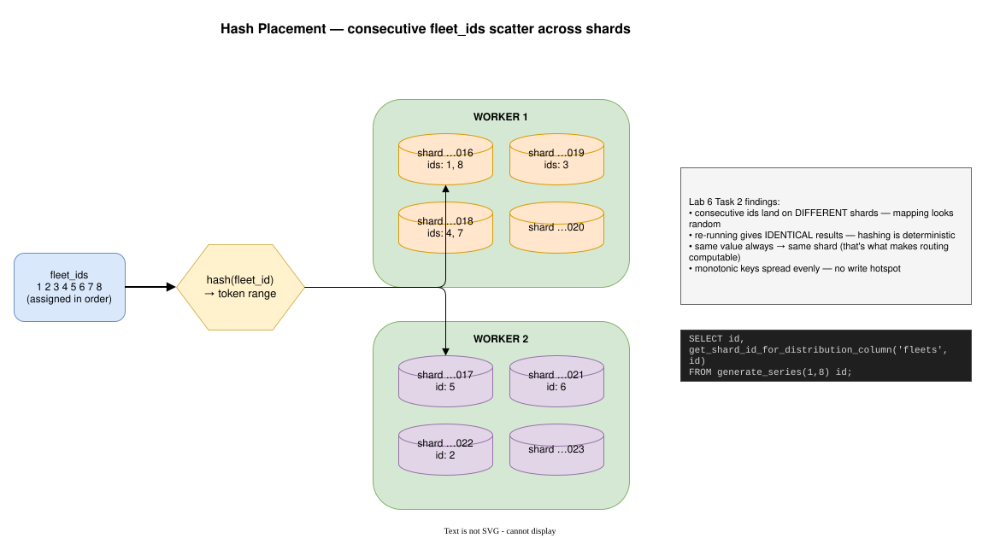
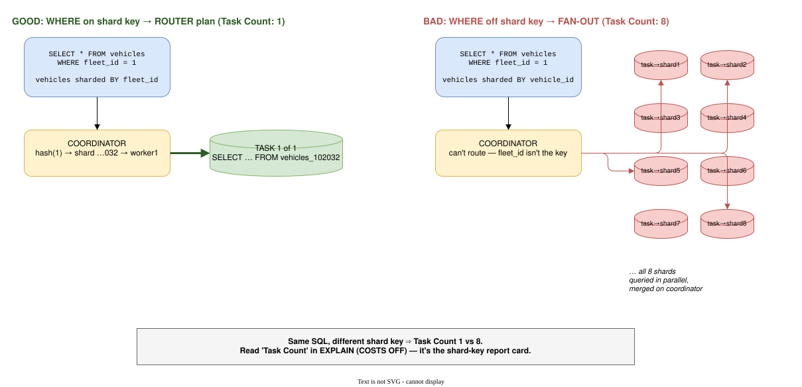
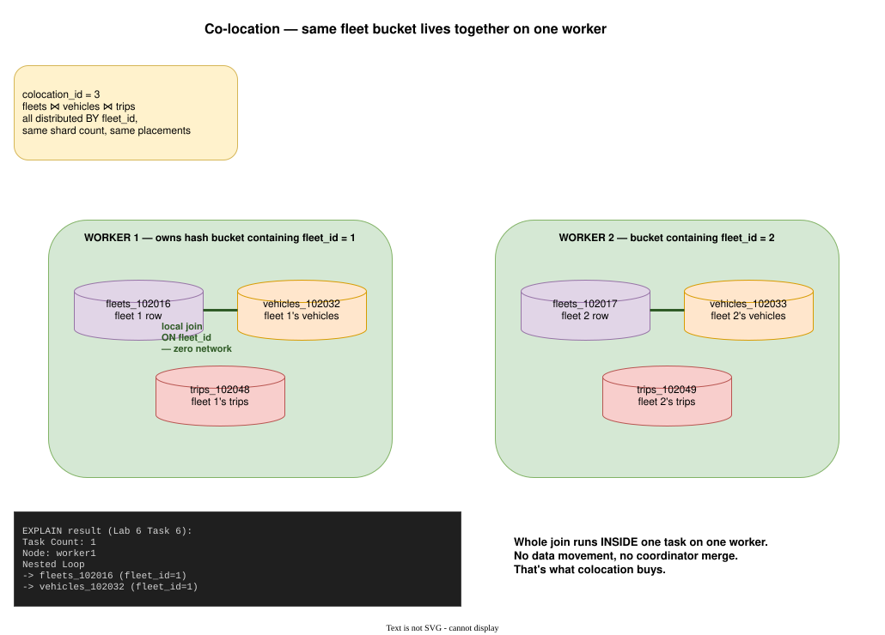
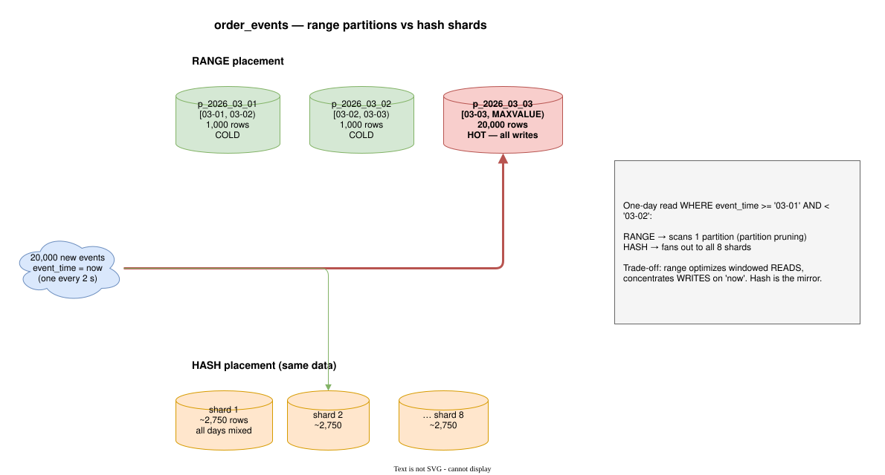

# Lab 6 — Choosing a Shard Key

**Module reference:** [Module 02](../modules/02-sharding-strategies.md) ·
[Module 04](../modules/04-choosing-a-shard-key.md) ·
[Module 05](../modules/05-query-routing.md) ·
[Module 07](../modules/07-range-and-timeseries.md)

## The problem

Deciding to split a table across a cluster is only the first decision. The next
one is harder: **which column to split on**. That column is the shard key —
Citus calls it the *distribution column*. It is the single most important
decision in a sharded design, and it is painful to change once data is in
place.

In this lab you work with bazaar's tables under different shard keys and
investigate, from the evidence, what each choice does to where rows are stored
and how queries run.

## In this lab you will explore

- **Starting state** — which tables Citus already manages, and by which column
- **Hash placement** — how Citus maps consecutive seller ids to shards, and
  whether the same id always lands in the same place
- **Cardinality and spread** — how evenly a distributed table's rows spread,
  and what decides that
- **Query routing** — how many shards a seller lookup touches under two
  different shard keys
- **Co-location** — how related tables that share a shard key behave in a join
- **Shard key immutability** — what happens when you try to change the shard
  key of an existing row
- **Range placement** — where a range-partitioned table puts a stream of new
  events, and which partitions a one-day query reads
- **Choosing a strategy** — which placement fits a time-based reporting
  workload, and what it costs

## Your environment

A Citus cluster runs in Docker. You connect to its coordinator on
`localhost:5432`. Database: `bazaar` — user `postgres` — no password.

Bazaar's tables:

| Table | One row per | Columns you will use |
| --- | --- | --- |
| `sellers` | seller profile | `seller_id` (PK), `store_name`, `display_name`. Leather Lane is `seller_id` 1, Copper Kettle 2, Maple & Pine 3. |
| `listings` | product listing | `seller_id` (the seller), `listing_id`, `title`, `price`. PK `(seller_id, listing_id)`. |
| `favorites` | buyer favorite | `seller_id` (the seller of the favorited listing), `listing_id`, `buyer_id` |
| `sellers_by_country` | seller | `seller_id`, `store_name`, `country` |

Connect at any time:

```bash
psql -h localhost -p 5432 -U postgres -d bazaar
```

> **Prerequisite:** complete Labs 1–5 first. This lab assumes `sellers` is
> distributed by `seller_id` into 8 shards.

---

## Task 1 — Inspect the starting state

**Goal:** Before you change anything, find out which of bazaar's four tables
(`sellers`, `listings`, `favorites`, `sellers_by_country`) Citus already
manages, and with which distribution column.

Useful view: `citus_tables` (columns: `table_name`, `citus_table_type`,
`distribution_column`, `shard_count`, `colocation_id`).

**Question:** Which statement matches the starting state of the cluster?

a) All four tables are distributed
b) `sellers` is distributed by `seller_id`, `sellers_by_country` by `country`;
   `listings` and `favorites` are still local tables
c) `sellers` is distributed by `store_name`; nothing else is distributed
d) Nothing is distributed

---

## Task 2 — Hash placement: map consecutive sellers to shards



Use this as a model of the routing steps, not a substitute for the actual shard
IDs returned by your cluster.

**Goal:** Seller ids are handed out in order: 1, 2, 3, and so on. `sellers` is
distributed by `seller_id`. Investigate where Citus places consecutive ids:

1. Find the shard that owns each `seller_id` from 1 to 8:

   ```sql
   SELECT id, get_shard_id_for_distribution_column('sellers', id) AS shardid
   FROM generate_series(1, 8) AS id;
   ```

2. Run the lookup a second time. Does any answer change?

**Question:** What do you observe about how consecutive seller ids map to
shards? (Think: is the mapping sequential? Random? Repeatable?)

---

## Task 3 — Cardinality and spread: how `sellers_by_country` is spread

**Goal:** `sellers_by_country` holds one row per seller, with the seller's
country, and is distributed by `country` into 8 shards. Investigate how its
rows are spread:

1. How many distinct countries does the table contain?

   ```sql
   SELECT count(DISTINCT country) FROM sellers_by_country;
   ```

2. How many of the 8 shards hold any rows?

   ```sql
   SELECT * FROM run_command_on_shards(
     'sellers_by_country', 'SELECT count(*) FROM %s');
   ```

3. What share of all rows does the fullest shard hold?

**Question:** Which statement matches what you found?

a) Rows spread evenly across all 8 shards
b) Only 5 shards hold rows, and one shard holds a large majority of all rows
c) Every shard holds exactly the same number of rows
d) All rows landed in one shard

Then answer: **why** does the spread look this way? What property of the
distribution column decides it?

---

## Task 4.1 — Query routing: distribute `listings` by `listing_id`

**Goal:** Each row of `listings` is one product. Its primary key is
`(seller_id, listing_id)`, so either column could be the shard key. Distribute
it by the *listing* id, in a co-location group of its own:

| Setting | Required value |
| --- | --- |
| Table | `listings` |
| Distribution column | `listing_id` |
| Number of shards | 8 |
| Co-location | A group of its own — not shared with any other table |

/// details | Hint
    type: hint

```sql
SELECT create_distributed_table(
  'listings', 'listing_id', shard_count := 8, colocate_with := 'none');
```

///

## Task 4.2 — Query routing: inspect a seller lookup on `listings`

**Goal:** Bazaar's most common request is *"show me this seller's listings"*.
`listings` is now distributed by `listing_id`. Investigate how Citus would run
that request for Leather Lane (`seller_id = 1`) — including how many shard
queries the plan contains:

```sql
EXPLAIN (COSTS OFF) SELECT * FROM listings WHERE seller_id = 1;
```

Count the `Task` nodes (each one is a query sent to a shard) and look at the
`Tasks Shown` line.

**Question:** What does the query plan show — one shard query, or many? Why?

---

## Task 5.1 — Query routing: redistribute `listings`, distribute `favorites`

**Goal:** Reconfigure to:

| Table | Distribution column | Co-located with |
| --- | --- | --- |
| `listings` | `seller_id` | `sellers` |
| `favorites` | `seller_id` | `sellers` |

`listings` is currently distributed by `listing_id`. A table's distribution
column **can't be changed in place**: turn it back into a regular table first,
then distribute it again:

```sql
SELECT undistribute_table('listings');
SELECT create_distributed_table('listings', 'seller_id', colocate_with := 'sellers');
```

Note: `colocate_with` and `shard_count` can't be given together — co-location
means *same shard count and same placement as the other table*, so Citus
inherits `sellers`' 8 shards automatically.

`favorites` is still a local table — each row records one favorite, and its
`seller_id` is the seller of the favorited listing:

```sql
SELECT create_distributed_table('favorites', 'seller_id', colocate_with := 'sellers');
```

## Task 5.2 — Query routing: inspect the seller lookup again



Compare the two paths with your plans from Tasks 4.2 and 5.2. Look for task
count, workers contacted, and whether the coordinator must merge results.

**Goal:** `listings` is now distributed by `seller_id`, co-located with
`sellers`. Investigate how Citus runs *"show me this seller's listings"* now:

```sql
EXPLAIN (COSTS OFF) SELECT * FROM listings WHERE seller_id = 1;  -- Leather Lane
EXPLAIN (COSTS OFF) SELECT * FROM listings WHERE seller_id = 2;  -- Copper Kettle (never looked up before)
```

For each: how many shard queries does the plan contain, and on which node?

**Question:** What do the query plans show now, compared with Task 4.2?

---

## Task 6 — Co-location: join two co-located tables



Follow one seller's rows across the two tables. Matching shard-key values and
co-location let the worker perform the join without shipping those rows between
workers. Confirm this with your metadata and query plan.

**Goal:** `sellers`, `listings`, and `favorites` are all distributed by
`seller_id`. Investigate:

1. The co-location group (`colocation_id`) of each of the three tables:

   ```sql
   SELECT table_name, colocation_id FROM citus_tables
   WHERE table_name IN ('sellers','listings','favorites')::regclass[];
   ```

   (If `IN` on regclass array is awkward, run three queries or use
   `WHERE table_name::text IN ('sellers','listings','favorites')`.)

2. How many shard queries Citus plans for a join listing a seller's store name
   next to each of their listings:

   ```sql
   EXPLAIN (COSTS OFF)
   SELECT s.store_name, l.title
   FROM sellers s JOIN listings l USING (seller_id)
   WHERE s.seller_id = 1;
   ```

   Then repeat for `seller_id = 3` (Maple & Pine).

**Question:** What do the co-location groups and the join plans show? Where does
the join actually run?

---

## Task 7.1 — Shard key immutability: try to change a row's shard key

**Goal:** Find out what happens when you try to change the `seller_id` of an
existing seller.

1. Add a test seller:

   ```sql
   INSERT INTO sellers VALUES (20001, 'shardkey_demo', 'Shard Key Demo');
   ```

2. Try to change that seller's `seller_id` to 20002 with an `UPDATE`. Note
   exactly what happens — read the error.

3. Move the seller instead: in a **single transaction**, insert seller 20002
   with store name `shardkey_demo_moved` (same display name) and delete
   seller 20001.

When you finish, `sellers` must contain seller 20002 (`shardkey_demo_moved`)
and no seller 20001.

/// details | Hint for step 3
    type: hint

```sql
BEGIN;
INSERT INTO sellers VALUES (20002, 'shardkey_demo_moved', 'Shard Key Demo');
DELETE FROM sellers WHERE seller_id = 20001;
COMMIT;
```

///

## Task 7.2 — Shard key immutability: why the update was refused

**Goal:** Citus refused to change seller 20001's `seller_id` to 20002 with an
`UPDATE`, but accepted the same change as insert + delete. Investigate:

1. Which shard owns `seller_id = 20001`, which owns `seller_id = 20002`, and
   which worker holds each of those shards:

   ```sql
   SELECT get_shard_id_for_distribution_column('sellers', 20001) AS old_shard,
          get_shard_id_for_distribution_column('sellers', 20002) AS new_shard;
   ```

   Then look up those shard ids in `citus_shards`.

2. Does Citus accept an `UPDATE` that changes a *different* column of
   seller 20002 — e.g. `display_name`?

   ```sql
   UPDATE sellers SET display_name = 'Shard Key Demo (moved)'
   WHERE seller_id = 20002;
   ```

**Question:** What explains Citus's behaviour? (Hint: an UPDATE that changes
the distribution column is really a **move between shards** — possibly between
machines — not an in-place update.)

---

## Task 8.1 — Range placement: build a range-partitioned table

**Goal:** With **range placement**, each shard owns one continuous span of key
values. Model this on the coordinator with a plain PostgreSQL table split into
range partitions — each partition stands in for one range shard.

> **Note:** this task uses plain PostgreSQL, not Citus. All partitions live on
> the coordinator. Citus places rows by hash, so a partitioned table is the
> simplest way to see how range placement behaves.

Create `order_events`, partitioned by range on `event_time`:

| Setting | Required value |
| --- | --- |
| Table | `order_events` |
| Columns | `event_time timestamp`, `event int`, `seller_id int` |
| Partition method | `RANGE` on `event_time` |

Give it these three partitions:

| Partition | From (included) | To (not included) |
| --- | --- | --- |
| `order_events_p2026_03_01` | 2026-03-01 | 2026-03-02 |
| `order_events_p2026_03_02` | 2026-03-02 | 2026-03-03 |
| `order_events_p2026_03_03` | 2026-03-03 | MAXVALUE (no upper limit) |

/// details | Hint
    type: hint

```sql
CREATE TABLE order_events (
  event_time timestamp NOT NULL,
  event      int,
  seller_id  int
) PARTITION BY RANGE (event_time);

CREATE TABLE order_events_p2026_03_01 PARTITION OF order_events
  FOR VALUES FROM ('2026-03-01') TO ('2026-03-02');
CREATE TABLE order_events_p2026_03_02 PARTITION OF order_events
  FOR VALUES FROM ('2026-03-02') TO ('2026-03-03');
CREATE TABLE order_events_p2026_03_03 PARTITION OF order_events
  FOR VALUES FROM ('2026-03-03') TO (MAXVALUE);
```

///

Then load data — run these two statements exactly as given. The first adds
1,000 older events on each of the first two days; the second simulates 20,000
new events arriving on the latest day, one every 2 seconds:

```sql
INSERT INTO order_events (event_time, event, seller_id)
SELECT d + g * interval '1 minute', g % 5 + 1, g % 1000 + 1
FROM (VALUES (timestamp '2026-03-01'), (timestamp '2026-03-02')) AS days(d),
     generate_series(0, 999) AS g;

INSERT INTO order_events (event_time, event, seller_id)
SELECT timestamp '2026-03-03' + g * interval '2 seconds', g % 5 + 1, g % 1000 + 1
FROM generate_series(0, 19999) AS g;
```

### Verify

- [ ] `order_events` is partitioned by range on `event_time` (`\d+ order_events`)
- [ ] It has exactly three partitions
- [ ] `order_events_p2026_03_03` covers 2026-03-03 onwards with no upper limit
- [ ] The table holds all 22,000 events

## Task 8.2 — Range placement: where did the new events go?



In this task the ranges are native PostgreSQL partitions, not Citus shards on
different workers. Use the comparison to reason about write concentration and
read pruning, then check the partition counts and scans below.

**Goal:** `order_events` is split on `event_time` into range partitions.
Investigate:

1. Which partitions exist and which span of time each covers:

   ```sql
   SELECT inhrelid::regclass AS partition, pg_get_expr(c.relpartbound, c.oid) AS bounds
   FROM pg_inherits i JOIN pg_class c ON c.oid = i.inhrelid
   WHERE i.inhparent = 'order_events'::regclass;
   ```

2. How many rows each partition holds (query each partition directly, or
   `SELECT event_time::date AS day, count(*) FROM order_events GROUP BY 1`).

3. Which partition(s) hold the 20,000 new events (`event_time` >= 2026-03-03)?

4. How many partitions PostgreSQL reads for a one-day query:

   ```sql
   EXPLAIN (COSTS OFF)
   SELECT * FROM order_events
   WHERE event_time >= '2026-03-01' AND event_time < '2026-03-02';
   ```

   Look at the scans in the plan — how many partition tables appear?

**Question:** What does this show about range placement — for writes *and* for
reads?

---

## Task 9 — Choosing a strategy: pick a placement for weekly reports

**Scenario:** Bazaar adds an `events` table recording every action buyers
take. Its main workload is weekly reports such as:

```sql
SELECT * FROM events
WHERE event_time >= '2026-03-01' AND event_time < '2026-03-08';
```

New events arrive continuously, always with the current time.

**Question:** Which placement strategy — hash or range — best fits this
workload, and which trade-off comes with it? Answer in 2–4 sentences. Consider:

- What does each strategy do to the report query (how many shards/partitions
  does it touch)?
- What does each strategy do to the *write* stream (which shards absorb the
  inserts)?

---

## Finishing up

You should now be able to explain, with evidence from this cluster:

- why hash placement spreads consecutive ids evenly but scatters range queries,
- why a low-cardinality shard key (`country`) creates skewed shards,
- why `seller_id` turns a seller lookup into a single-shard query while
  `listing_id` fans out to every shard,
- what co-location buys you in a join,
- why shard keys are effectively immutable,
- why range placement is perfect for time-based reads and terrible for
  balanced writes.

*Answers and expected output: [solutions/lab-06-solutions.md](../solutions/lab-06-solutions.md).*
