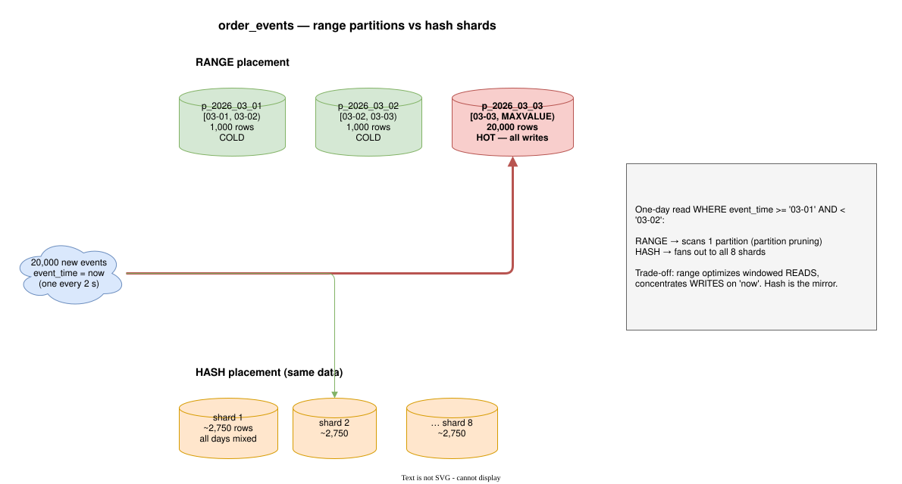
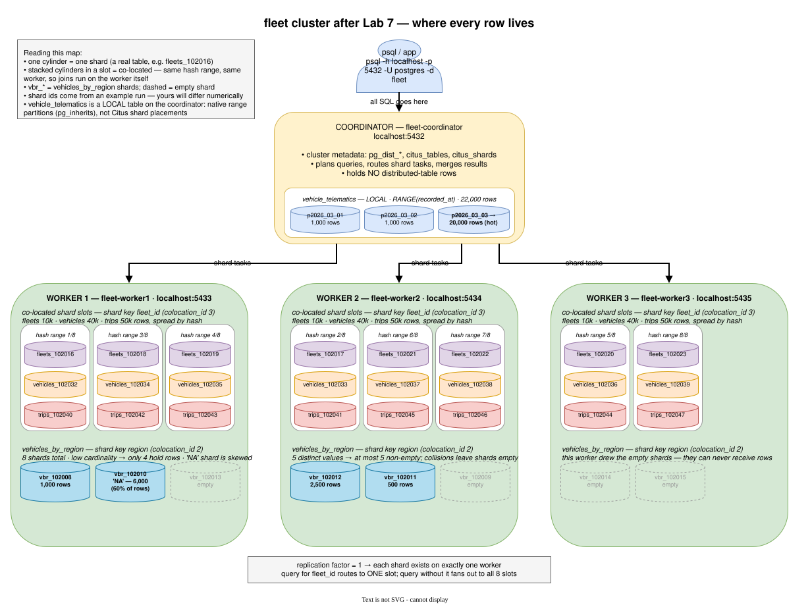

# Lab 7 — Range Partitioning

**Module reference:** [Module 02](../modules/02-sharding-strategies.md) ·
[Module 07](../modules/07-range-and-timeseries.md)

## The problem

Sharding answers *"which machine holds this row?"* — but it says nothing about
*time*. The fleet platform's next requirement is telematics history: GPS pings
arrive continuously, reports read time windows, and old pings will eventually
expire. Hashing `fleet_id` spreads those pings beautifully across workers and
scatters every day's data across all of them — the worst possible layout for a
query that only wants last Tuesday.

**Range placement** is the complement: each slice owns one continuous span of
key values. In this lab you model it with a plain PostgreSQL partitioned table
on the coordinator, measure where writes and reads actually go, and decide
when range beats hash. Lab 8 then stacks the two: a *distributed* partitioned
table.

## In this lab you will explore

- **Range placement** — where a range-partitioned table puts a stream of new
  pings, and which partitions a one-day query reads
- **Partition pruning** — how PostgreSQL skips partitions whose bounds can't
  match the predicate, and which predicates *can't* prune
- **Partitions vs shards** — why `pg_inherits`, not `citus_shards`, describes
  this table's children
- **Retention as a metadata operation** — expiring a whole day by detaching
  one partition instead of deleting millions of rows
- **Choosing a strategy** — which placement fits a time-based reporting
  workload, and what it costs

## Your environment

Same Citus cluster, same `fleet` database. After Lab 6 the cluster holds:
`fleets`, `vehicles`, and `trips` distributed by `fleet_id` and co-located
(8 shards each), `vehicles_by_region` distributed by `region`, and
`service_zones` still local. Leave all of them untouched — this lab adds one
new *local* table.

> **Prerequisite:** complete Labs 1–6 first. This lab assumes the distributed
> state Lab 6 ends in; do not reset the cluster.

Connect at any time:

```bash
psql -h localhost -p 5432 -U postgres -d fleet
```

---

## Task 1 — Range placement: build a range-partitioned table

**Goal:** With **range placement**, each slice owns one continuous span of key
values. Model this on the coordinator with a plain PostgreSQL table split into
range partitions — each partition stands in for one range shard.

> **Note:** this task uses plain PostgreSQL, not Citus. All partitions live on
> the coordinator. Citus places rows by hash, so a partitioned table is the
> simplest way to see how range placement behaves — before Lab 8 combines both.

Create `vehicle_telematics`, partitioned by range on `recorded_at`:

| Setting | Required value |
| --- | --- |
| Table | `vehicle_telematics` |
| Columns | `recorded_at timestamp`, `fleet_id bigint`, `vehicle_id bigint`, `speed_kph numeric(5,2)`, `location geometry(Point,4326)` |
| Partition method | `RANGE` on `recorded_at` |

Give it these three partitions:

| Partition | From (included) | To (not included) |
| --- | --- | --- |
| `vehicle_telematics_p2026_11_14` | 2026-11-14 | 2026-11-15 |
| `vehicle_telematics_p2026_11_15` | 2026-11-15 | 2026-11-16 |
| `vehicle_telematics_p2026_11_16` | 2026-11-16 | MAXVALUE (no upper limit) |

/// details | Hint
    type: hint

```sql
CREATE TABLE vehicle_telematics (
  fleet_id    bigint NOT NULL,
  vehicle_id  bigint NOT NULL,
  recorded_at timestamp NOT NULL,
  speed_kph   numeric(5,2),
  location    geometry(Point,4326)
) PARTITION BY RANGE (recorded_at);

CREATE TABLE vehicle_telematics_p2026_11_14 PARTITION OF vehicle_telematics
  FOR VALUES FROM ('2026-11-14') TO ('2026-11-15');
CREATE TABLE vehicle_telematics_p2026_11_15 PARTITION OF vehicle_telematics
  FOR VALUES FROM ('2026-11-15') TO ('2026-11-16');
CREATE TABLE vehicle_telematics_p2026_11_16 PARTITION OF vehicle_telematics
  FOR VALUES FROM ('2026-11-16') TO (MAXVALUE);
```

///

Then load data — run these two statements exactly as given. The first adds
1,000 pings on each of the first two days, spread across fleets 1–1000 in the
NYC metro area; the second simulates 20,000 pings arriving on the latest day,
one every 2 seconds, clustered inside the Newark Airport geofence:

```sql
INSERT INTO vehicle_telematics (fleet_id, vehicle_id, recorded_at, speed_kph, location)
SELECT (g % 1000) + 1, (g % 4) + 1, d + g * interval '1 minute',
       ((g * 7) % 900)::numeric(5,2) / 10,
       ST_SetSRID(ST_MakePoint(-74.0 - (g % 100) / 1000.0,
                                40.7 + (g % 80) / 1000.0), 4326)
FROM (VALUES (timestamp '2026-11-14'), (timestamp '2026-11-15')) AS days(d),
     generate_series(0, 999) AS g;

INSERT INTO vehicle_telematics (fleet_id, vehicle_id, recorded_at, speed_kph, location)
SELECT (g % 1000) + 1, (g % 4) + 1, timestamp '2026-11-16' + g * interval '2 seconds',
       ((g * 7) % 900)::numeric(5,2) / 10,
       ST_SetSRID(ST_MakePoint(-74.16 - (g % 30) / 1000.0,
                                40.68 + (g % 40) / 1000.0), 4326)
FROM generate_series(0, 19999) AS g;
```

### Verify

- [ ] `vehicle_telematics` is partitioned by range on `recorded_at` (`\d+ vehicle_telematics`)
- [ ] It has exactly three partitions
- [ ] `vehicle_telematics_p2026_11_16` covers 2026-11-16 onwards with no upper limit
- [ ] The table holds all 22,000 pings

## Task 2 — Range placement: where did the new pings go?



In this task the ranges are native PostgreSQL partitions, not Citus shards on
different workers. Use the comparison to reason about write concentration and
read pruning, then check the partition counts and scans below.

**Goal:** `vehicle_telematics` is split on `recorded_at` into range partitions.
Investigate:

1. Which partitions exist and which span of time each covers:

   ```sql
   SELECT inhrelid::regclass AS partition, pg_get_expr(c.relpartbound, c.oid) AS bounds
   FROM pg_inherits i JOIN pg_class c ON c.oid = i.inhrelid
   WHERE i.inhparent = 'vehicle_telematics'::regclass;
   ```

2. How many rows each partition holds (query each partition directly, or
   `SELECT recorded_at::date AS day, count(*) FROM vehicle_telematics GROUP BY 1`).

3. Which partition(s) hold the 20,000 new pings (`recorded_at` >= 2026-11-16)?

4. How many partitions PostgreSQL reads for a one-day query:

   ```sql
   EXPLAIN (COSTS OFF)
   SELECT * FROM vehicle_telematics
   WHERE recorded_at >= '2026-11-14' AND recorded_at < '2026-11-15';
   ```

   Look at the scans in the plan — how many partition tables appear?

**Question:** What does this show about range placement — for writes *and* for
reads?

---

## Task 3 — Connect partitions to the shard investigation

**Goal:** repeat Lab 5's row-location and row-count checks, now for native
partitions. These queries only inspect the table created in Task 1.

```sql
SELECT tableoid::regclass AS physical_partition, count(*) AS rows
FROM vehicle_telematics
GROUP BY tableoid
ORDER BY physical_partition::text;

SELECT count(*) AS parent_rows FROM vehicle_telematics;

SELECT recorded_at, tableoid::regclass AS physical_partition
FROM vehicle_telematics
WHERE recorded_at IN (
  timestamp '2026-11-14 00:00:00',
  timestamp '2026-11-15 00:00:00',
  timestamp '2026-11-16 00:00:00'
)
ORDER BY recorded_at;
```

1. Do the physical child counts sum to the parent count, as shard counts did
   for `fleets` in Lab 5?
2. Which child holds a ping exactly at midnight on Nov 15? Explain the
   inclusive lower bound and exclusive upper bound.
3. Do these children live on workers? Why would `pg_inherits`, rather than
   `citus_shards`, describe this particular table's children?

Now compare with Task 2's time-filtered plan:

```sql
EXPLAIN (COSTS OFF)
SELECT * FROM vehicle_telematics WHERE fleet_id = 1;
```

**Question:** how many partitions remain in this plan? Explain why the same
fleet predicate that selected one Citus shard earlier cannot prune this table's
time partitions. Distinguish partition pruning from index access within a child.

## Task 4 — Plan retention without changing the lab state

**Scenario:** The platform wants to retain pings from Nov 15 onwards. Identify
the whole partition whose upper bound is at or before that cutoff. Do not detach
or drop anything: Lab 8 still uses all 22,000 rows.

```sql
SELECT count(*) AS rows_before_cutoff
FROM vehicle_telematics
WHERE recorded_at < timestamp '2026-11-15';
```

Write down:

1. The candidate partition, its row count, and the parent count that would be
   visible after detaching it.
2. How detaching an archive differs from dropping it. Would a row-by-row
   `DELETE` be necessary if the entire interval expires?
3. Why the open-ended Nov 16 partition prevents simply adding a Nov 17 daily
   partition with overlapping bounds. What would you change in a production
   partition schedule?
4. If you later add `ping_id` and a primary key, why must a primary key on this
   partitioned parent include `recorded_at`? And if the table were *also*
   distributed by `fleet_id` (Lab 8's next step), what would the full PK have
   to include?

**Checkpoint:** fleet tables remain distributed as before; `vehicle_telematics`
is still local, partitioned, and contains 22,000 rows. You have changed the
storage strategy for a different workload, not undone the earlier labs.

## Task 5 — Choosing a strategy: pick a placement for weekly reports

**Scenario:** The platform adds a `pings` table recording every GPS fix the
fleet emits. Its main workload is weekly reports such as:

```sql
SELECT * FROM pings
WHERE recorded_at >= '2026-11-09' AND recorded_at < '2026-11-16';
```

New pings arrive continuously, always with the current time.

**Question:** Which placement strategy — hash or range — best fits this
workload, and which trade-off comes with it? Answer in 2–4 sentences. Consider:

- What does each strategy do to the report query (how many shards/partitions
  does it touch)?
- What does each strategy do to the *write* stream (which shards absorb the
  inserts)?

---

## Finishing up



Use this map as your reference for where every row ends up: the coordinator
keeps the catalogue and `vehicle_telematics`' native partitions, while each
worker holds roughly a third of the co-located `fleets`/`vehicles`/`trips`
shard slots and of the `vehicles_by_region` shards — several of them empty from the
low-cardinality `region` key.

You should now be able to explain, with evidence from this cluster:

- how native partitions differ from worker shards,
- how partition bounds and pruning serve time-window reads without adding nodes,
- why current writes concentrate in the newest range,
- why a fleet predicate that routes to one Citus shard cannot prune time
  partitions,
- why retention by detach/drop beats row-by-row `DELETE`.

**Next:** [Lab 8 — Distributed time-series & geofencing](lab-08-distributed-timeseries.md) —
distribute the partitioned table itself, put a spatial index inside each shard,
and expire a whole partition across the cluster.

*Stuck? See [solutions/lab-07-solutions.md](solutions/lab-07-solutions.md).*
