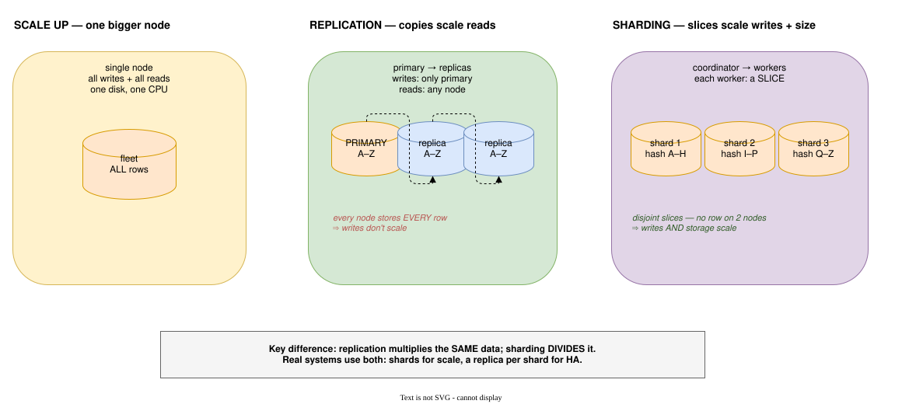

# Module 01 — Why Sharding?

## The scaling problem

A single PostgreSQL server has hard ceilings: CPU, RAM, IOPS, disk, connection
count. When a workload hits one of them you have three levers:

```text
   Scale UP              Scale OUT (reads)         Scale OUT (writes)
   ──────────            ─────────────────         ──────────────────
   bigger machine        replicas share reads     SHARDING: split the data
   │                     │                        │
   simple                read traffic scales      write AND read traffic scale
   has a ceiling         writes don't scale       complexity moves to the app/db
```

**Replication** copies the *same* data to more machines — great for read
throughput and availability, but every replica still writes every row. It does
nothing for a write-bound or data-too-big workload.

**Sharding** (horizontal partitioning across servers) gives each node a *slice*
of the data. N nodes ⇒ roughly N× the write capacity and N× the storage.

## Partitioning vs replication vs sharding

| Concept | One node or many? | What moves | Solves |
|---|---|---|---|
| Table partitioning | One node | Rows split into child tables on the same server | Huge-table manageability, pruning, retention |
| Replication | Many nodes | Whole dataset copied to every node | Read scaling, HA, failover |
| Sharding | Many nodes | Disjoint row slices, one per node | Write scaling, dataset > one disk |

A sharded system typically *also* replicates (each shard may have replicas) —
the two are complementary, not alternatives.



## The fleet telematics story

The platform runs fleets of delivery and ride-share vehicles. Every vehicle
streams GPS pings into telematics; geofences drive pricing and dispatch; trips
and driver records anchor the business. Growth:

- 10k fleets → 10M fleet-vehicles
- Telematics & trips grow ~100× faster than fleets (pings every few seconds)
- P99 latency on "show this fleet's live map" degrades as tables outgrow RAM

Sharding by `fleet_id` is the natural fit: a fleet's vehicles, pings, and trips
are self-contained, fleet traffic is roughly uniform, and "join a fleet to its
vehicles" stays inside one machine. Time adds a second axis — telematics
retention and time-window reads — which is where *partitioning* comes in on top
of sharding (Labs 7–8). We'll prove each claim with real query plans.

## What sharding costs

- **The shard key becomes load-bearing.** Choose wrong and you get hotspots or
  fan-out queries (Lab 6, Tasks 3–5).
- **Cross-shard operations are expensive.** Joins across shards mean data
  movement; cross-shard transactions need 2PC.
- **Resharding is a migration**, not a config change.
- **Uniqueness & foreign keys** only work inside a shard (or must include the
  shard key — as `vehicles_by_region`'s PK already demonstrates).

## When NOT to shard

- Your dataset fits comfortably on one well-sized node.
- Your bottleneck is reads (use replicas or a cache).
- Your queries are mostly cross-tenant analytics (consider a columnar store).
- You can't find a shard key that serves the dominant query patterns.

Sharding is a *scaling* tool, not a default architecture.

## Quick check

<quiz>
Your dataset fits comfortably on one well-sized node and the bottleneck is read traffic. What is the best move?
- [ ] Shard by `fleet_id` anyway
- [x] Add read replicas or a cache
- [ ] Reshard onto more nodes
- [ ] Convert the tables to reference tables

Sharding is a *scaling* tool, not a default architecture. Read bottlenecks are what replicas and caches are for.
</quiz>

<quiz>
Which costs does sharding introduce? (Select all that apply.)
- [x] The shard key becomes load-bearing — a bad choice causes hotspots or fan-out
- [x] Cross-shard joins require data movement and cross-shard transactions need 2PC
- [x] Resharding is a migration, not a config change
- [ ] Uniqueness constraints stop working entirely, even inside a shard

Uniqueness still works **inside** a shard (or when the constraint includes the shard key) — it just can't be enforced cluster-wide.
</quiz>

**Next:** [Module 02 — Sharding Strategies](02-sharding-strategies.md)
