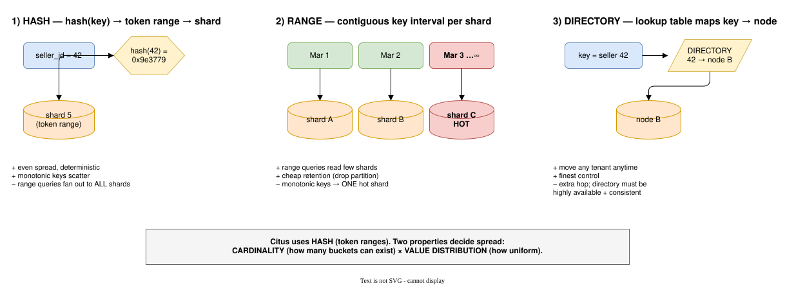

# Module 02 — Sharding Strategies

Once you've decided to shard, the routing rule — which shard gets which rows —
is *the* design decision. Four families:

## 1. Hash-based sharding

`shard = hash(key) mod N`. What Citus uses by default (a hash token range per
shard, rather than literal `mod`, so rebalancing moves ranges not rows).

**Pros:** near-perfectly uniform spread, even for monotonic keys — hashing
destroys ordering, so ids 1,2,3,… scatter (Lab 6, Task 2). Deterministic
routing: any value maps to exactly one shard, computable without lookups
(`get_shard_id_for_distribution_column`).

**Cons:** destroys *locality*. A range predicate (`recorded_at BETWEEN ...`) can
satisfy rows anywhere → the query fans out to every shard. For time-series
this is the classic trade-off — see Lab 7.

## 2. Range-based sharding

Each shard owns a contiguous interval of the key — e.g. one shard per day
(Lab 7 models this with native PG partitions, and Lab 8 distributes
them).

**Pros:** range queries touch only the shards whose intervals overlap — the
best possible read pattern for time windows — and an entire expired interval
becomes a cheap `DROP`.

**Cons:** monotonically increasing keys (timestamps, sequences) pour all writes
into the *last* shard — the **hot shard** problem. Older shards idle.

## 3. Directory / lookup-based sharding

A small mapping table (a "directory") records where each entity lives.
Extremely flexible — move a tenant by updating its directory entry — at the
cost of an extra lookup hop and a directory that must itself be highly
available and consistent.

## 4. Geographic / topology-aware sharding

Shard by region (`region`, `datacenter`). Solves data-residency and
latency-to-user problems, but inherits every skew problem of low-cardinality
keys — as Lab 6, Task 3 shows with `region`.

## The two properties that decide whether a shard key spreads load

1. **Cardinality** — number of distinct values bounds how many shards can ever
   hold data. 5 regions in 8 shards ⇒ ≥3 shards are empty forever.
2. **Value distribution** — uniform values ⇒ uniform shards. A key where one
   value covers 60% of rows puts 60% of data (and probably 60%+ of traffic) on
   one shard.

`fleet_id` passes both tests for the fleet workload: high cardinality (10k
fleets today, 10M vehicles later) and roughly uniform activity per fleet.
`region` fails both.

## Hotspots and monotonic keys

The classic trap: shard a `recorded_at` table *by range* → every insert hits the
newest shard. Or shard by *hash of timestamp* → balanced writes but every
dashboard fans out to all shards. There is no free lunch: **pick the placement
that optimizes your dominant workload, and pay the trade-off knowingly**
(Lab 7, Task 5). The production-grade answer — hash for spread *plus* native
partitions for time — is what Lab 8 builds.

## Consistent hashing (mention)

Rebalancing a `mod N` scheme reshuffles ~all rows when N changes. Consistent
hashing maps keys and nodes onto a ring so adding a node moves only ~1/N of
keys. Citus avoids the problem differently: it stores `shard → hash-token-range`
metadata and moves whole token ranges (`citus_move_shard_placement`,
rebalancer), so row-level mapping stays stable while placements move.

## Quick check

<quiz>
A table is sharded by `region`, which has 5 distinct values, across 8 shards. What happens?
- [ ] Rows spread evenly because hashing fills gaps
- [x] At least 3 shards stay empty forever
- [ ] Citus automatically splits hot regions into extra shards
- [ ] The table becomes a reference table

**Cardinality** bounds how many shards can ever hold data — 5 values can fill at most 5 shards.
</quiz>

<quiz>
You shard a table *by range* on `recorded_at`. What goes wrong on writes?
- [ ] Writes are rejected because timestamps are immutable
- [ ] Writes fan out to every shard
- [x] Every insert hits the newest shard — a hotspot
- [ ] Nothing; range sharding is always balanced

Monotonic keys under range placement funnel all current writes into one shard. Hashing the timestamp fixes write spread but makes every dashboard query fan out — there is no free lunch.
</quiz>

**Next:** [Module 03 — Citus Architecture](03-citus-architecture.md)
