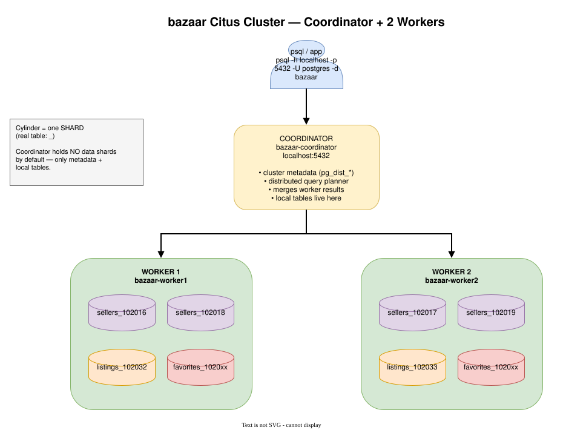

# Module 03 — Citus Architecture

Citus turns a fleet of PostgreSQL servers into one logical, sharded database.
It is a PostgreSQL **extension** — not a fork — so every node is just Postgres
with extra superpowers (ours also carry PostGIS, since the workload is
geospatial).

## Roles

```text
   app / psql
       │
       ▼
┌──────────────┐        ┌──────────────┐
│ COORDINATOR  │───────▶│  WORKER 1    │  shards: fleets_102016 … _102019
│ localhost    │        │  citus+pg    │
│   :5432      │───────▶│  WORKER 2    │  shards: fleets_102020 … _102023
│ metadata,    │        └──────────────┘
│ planning,    │
│ merge        │
└──────────────┘
```



- **Coordinator** — owns the cluster metadata, plans distributed queries, sends
  per-shard tasks to workers, merges results. By default holds no data shards.
- **Workers** — hold shards as ordinary tables named `<table>_<shardid>`
  (`fleets_102016`), execute shard queries, return partial results.

The coordinator you meet in the labs is a regular Postgres you can also keep
local tables on — which is exactly what `vehicles` and `trips` are before
you distribute them.

## The three table types

| Type | Metadata | Physical rows | Use for |
|---|---|---|---|
| `distributed` | in `citus_tables` | sharded across workers by the distribution column | big, high-traffic tables |
| `reference` | in `citus_tables` | **full copy on every worker** | small lookups/dimensions joined everywhere (`service_zones`, `regions`) |
| local | absent | only on coordinator | everything else |

## Shards and placements

- **Shard** — logical slice of a distributed table. Defined by a *hash token
  range* in `pg_dist_shard` (`shardminvalue`/`shardmaxvalue`).
- **Placement** — a physical copy of a shard on a node
  (`pg_dist_shard_placement`). Replication factor 1 ⇒ one placement per shard.

Metadata cheat sheet (all queried in labs):

| Object | Contents |
|---|---|
| `citus_tables` | managed tables, type, distribution column, shard count, `colocation_id` |
| `citus_shards` | every shard: id, table-name suffix, node, size — the friendliest view |
| `pg_dist_node` | node registry |
| `pg_dist_shard` | shard → hash-token range |
| `pg_dist_shard_placement` | shard → node placements |
| `pg_dist_colocation` | co-location groups |

Helpers you'll use: `citus_get_active_worker_nodes()`,
`get_shard_id_for_distribution_column(table, value)`,
`run_command_on_shards(table, 'SQL with %s')`.

## How a query flows

1. psql/app sends SQL to the **coordinator**.
2. The planner inspects `WHERE` on the distribution column. One value ⇒ it can
   compute the target shard (`hash(value)` → token range → shard → placement →
   node) and emits a **router** plan (`Task Count: 1`).
3. No filter on the distribution column ⇒ **adaptive/scatter-gather** plan: one
   task per shard, run in parallel, results merged on the coordinator.
4. The coordinator stitches rows together and returns them — the client can't
   tell the difference (until it looks at latency or `EXPLAIN`).

## Co-location

Two tables distributed by the same column type, shard count, and placements
share a **co-location group** (`colocation_id`). Guarantees: shard N of table A
and shard N of table B live on the same worker ⇒ joins on the distribution
column run *inside* the worker as local joins (Lab 6, Task 6).
`colocate_with := 'fleets'` inherits both the shard count and placement —
which is why you can't pass `shard_count` alongside it.

## Quick check

<quiz>
What physically lives on each worker for a `reference` table?
- [ ] One shard of the table
- [ ] Only the metadata row in `citus_tables`
- [x] A full copy of the table
- [ ] Nothing — reference tables live on the coordinator only

Reference tables are small lookups/dimensions copied to **every** worker so joins stay local. Distributed tables are sharded; local tables exist only on the coordinator.
</quiz>

<quiz>
In Citus terms, what is a *placement*?
- [ ] The hash-token range that defines a shard
- [x] A physical copy of a shard on a node
- [ ] A partition of a range-sharded table
- [ ] A registered worker in `pg_dist_node`

A **shard** is the logical slice (a token range in `pg_dist_shard`); a **placement** is a physical copy of it on a node (`pg_dist_shard_placement`). Replication factor 1 ⇒ one placement per shard.
</quiz>

**Next:** [Module 04 — Choosing a Shard Key](04-choosing-a-shard-key.md)
