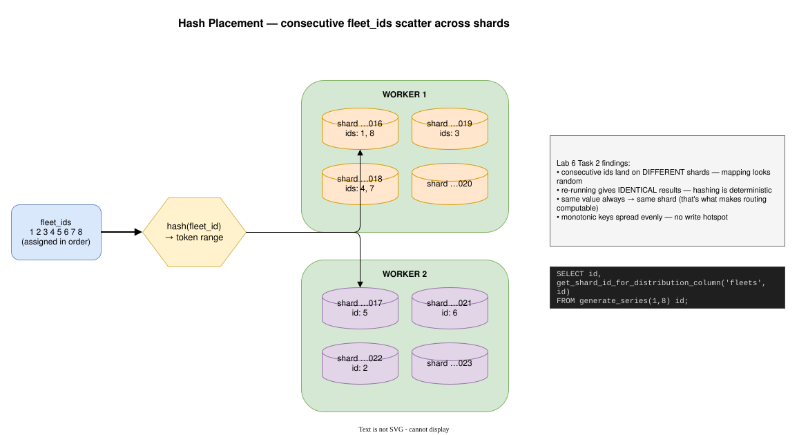

# Module 04 — Choosing a Shard Key

The distribution column is a one-way door. `undistribute_table` +
`create_distributed_table` will move you, but on a real dataset that's a
migration. Evaluate candidates against five criteria:

## The five criteria

| Criterion | Question | fleet example |
|---|---|---|
| Cardinality | Enough distinct values to fill every shard? | `fleet_id` ✓ (10k→10M); `region` ✗ (5) |
| Uniformity | Do values spread load evenly? | `fleet_id` ✓; `region` puts 60% in one shard |
| Query alignment | Do dominant queries filter on it? | "this fleet's vehicles/pings" filters `fleet_id` ✓ |
| Co-location potential | Do related tables share it? | fleets/vehicles/trips/telematics all carry `fleet_id` |
| Immutability | Does the value ever change? | ids never change; a `status` column would |

The ideal shard key is **a column that appears in most of your queries AND
splits data evenly**. When those pull in opposite directions, query alignment
usually wins — a slightly uneven single-shard query beats an even fan-out.

## Primary keys must contain the shard key

Citus enforces: every `UNIQUE`, `PRIMARY KEY`, or foreign-key constraint on a
distributed table must **include the distribution column**. That's why
`vehicles` is keyed `(fleet_id, vehicle_id)` and `vehicles_by_region` is keyed
`(region, vehicle_id)` — uniqueness can only be checked inside a shard without
a cluster-wide lock.

A table that is *also* natively partitioned stacks the rules: the PK must
include the distribution column **and** every partition-key column — e.g.
telematics needs `(fleet_id, recorded_at, …)`. Module 07 and Lab 8 show this.

## Shard key immutability

`UPDATE` on the distribution column is refused:
`ERROR: modifying the partition value of rows is not allowed`. The update is
really a row *move* between shards — possibly across machines. Citus makes you
say so explicitly: `INSERT` the new row + `DELETE` the old in one transaction
(Lab 6, Task 7). Design consequence: **never shard on a mutable attribute**.

## How many shards?

- Too few ⇒ coarse rebalancing, big shards.
- Too many ⇒ metadata and per-shard-query overhead.
- Citus default is 32; this course uses **8** so three workers get a visible
  ~3/3/2 split. Pick a number ≥ expected max nodes so rebalancing (not
  resharding) absorbs growth.

Note the multiplier when a table is *also* partitioned: N shards × M partitions
= N×M shard objects in the cluster. That overhead is real — Lab 8 shows what it
looks like in `citus_shards`.

## Rebalancing vs resharding

- **Rebalancing** (`rebalance_table_shards()`): move existing shards between
  workers. Online, cheap-ish — fixes *placement* imbalance.
- **Resharding** (change shard count or key): rewrites every row's placement —
  fixes a *design* mistake, expensively.

Co-location ties related tables to one shard count, so rebalance them together
via the colocation group.

## Anti-patterns

- Shard key with one dominant value (a `region='NA'` shard). → hotspot.
- Monotonic range key on an append-only stream. → write hotspot.
- Low-cardinality enum (`status`, `type`, `region`). → empty shards + skew.
- Key absent from the hot queries. → permanent fan-out.

## Quick check

<quiz>
Why is `vehicles` keyed `(fleet_id, vehicle_id)` instead of just `vehicle_id`?
- [ ] Composite keys are faster in Postgres
- [x] Every UNIQUE/PRIMARY KEY on a distributed table must include the distribution column
- [ ] `vehicle_id` alone is not unique
- [ ] Citus requires two-column primary keys

Uniqueness can only be checked inside a shard without a cluster-wide lock, so Citus enforces that constraints include the shard key.
</quiz>

<quiz>
Which of the five shard-key criteria does `region` fail for the fleet workload? (Select all that apply.)
- [x] Cardinality — only ~5 distinct values
- [x] Uniformity — one region holds ~60% of rows
- [ ] Immutability — regions never change, so it passes
- [ ] Query alignment — it passes because queries filter on it anyway

`region` fails the two properties that spread load: too few values and a skewed distribution. `fleet_id` passes both.
</quiz>

**Next:** [Module 05 — Query Routing](05-query-routing.md)
