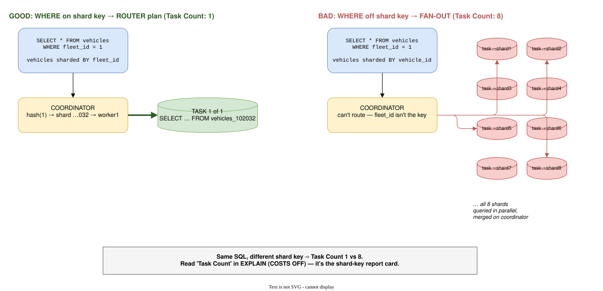
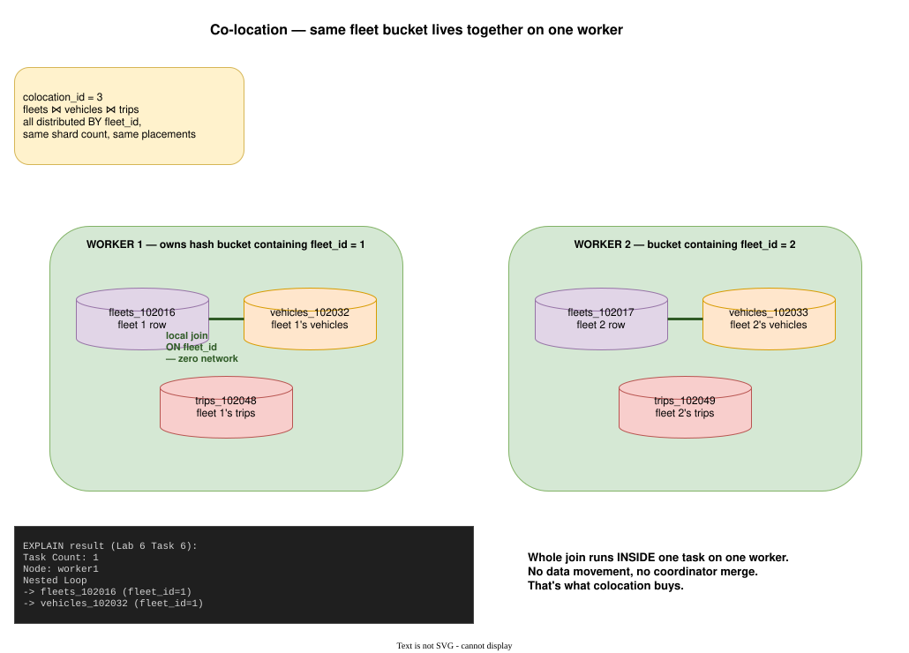

# Module 05 — Query Routing: How Citus Executes SQL

Reading a Citus `EXPLAIN` is the core skill of this course. Two plan shapes
matter.

## Router (single-shard) query

```sql
EXPLAIN (COSTS OFF) SELECT * FROM listings WHERE seller_id = 1;
```

```
Custom Scan (Citus Adaptive)
  Task Count: 1
  Tasks Shown: All
  -> Task
       Node: host=worker1 port=5432 dbname=bazaar
       -> Bitmap Heap Scan on listings_10203x ...
```

`seller_id` is the distribution column ⇒ `hash(1)` names exactly one shard ⇒
one task on one node. `Task Count` is the tell. Latency ≈ a single-node query
on 1/8th of the data.

## Scatter-gather (fan-out) query

Same query when `listings` was distributed by `listing_id`:

```
Custom Scan (Citus Adaptive)
  Task Count: 8
  Tasks Shown: One of 8
  -> Task ... (one task sent to every shard)
```

`seller_id` isn't the shard key ⇒ every shard might hold a matching row ⇒ one
task per shard, results merged on the coordinator. Cost ≈ max(shard latencies)
+ merge — and it burns CPU on *every* worker for *every* request.

`Tasks Shown: One of N` means Citus printed one representative task; the other
N−1 are structurally identical.



## Where the work happens

| Query shape | Runs on workers | Runs on coordinator |
|---|---|---|
| Router | everything | pass-through |
| Scatter-gather + aggregate | per-shard partial `count/sum` | final merge |
| Co-located join | entire join inside one task | pass-through |
| Non-co-located join | fetch shards | move data, local join, or repartition subplans (`Distributed Subplan`) |
| Cross-shard UPDATE/DELETE | per-shard | must touch multiple shards → restrictions apply |

Rule of thumb: the more the plan looks like *one task doing real Postgres work
on one worker*, the better your shard key serves that query.

## Executors (a note on names)

Older docs distinguish the *router executor* (single-shard) from the
*real-time/adaptive executor* (multi-shard, parallel). Citus 12 plans both
under `Custom Scan (Citus Adaptive)` — the `Task Count` is what you read.

## Co-located joins

When `sellers ⋈ listings` share `colocation_id` and join `USING (seller_id)`:

```
Task Count: 1
-> Task
     Node: host=worker1
     -> Nested Loop
          -> Index Scan on sellers_102016
          -> Bitmap Heap Scan on listings_102032
```

The coordinator ships the whole join to the worker; shard 102016 of `sellers`
and shard 102032 of `listings` are the same bucket of seller ids on the same
machine. Zero data movement.



## Transactions across shards

Single-shard statements keep normal Postgres semantics. Statements touching
multiple shards run with one connection per node; multi-statement transactions
spanning shards are coordinated with **two-phase commit** (2PC) to stay atomic —
supported, but slower and with more failure modes. Design so your hot
transactions stay single-shard.

## Quick check

<quiz>
A query has `WHERE seller_id = 42` on a table distributed by `seller_id`. How does Citus execute it?
- [ ] Scatter-gather across all workers
- [x] Router query to the single shard holding that value
- [ ] It runs entirely on the coordinator
- [ ] It is rejected — point lookups aren't supported

Equality on the distribution column lets the coordinator compute the shard and route to one node. Any other filter fans out.
</quiz>

<quiz>
What keeps a transaction spanning multiple shards atomic in Citus?
- [ ] Eventual consistency
- [ ] Reference tables
- [ ] The rebalancer
- [x] Two-phase commit (2PC)

2PC works but is slower and adds failure modes — design so hot transactions stay single-shard.
</quiz>

**Next:** [Module 06 — Resharding & Limits](06-resharding-and-limits.md)
