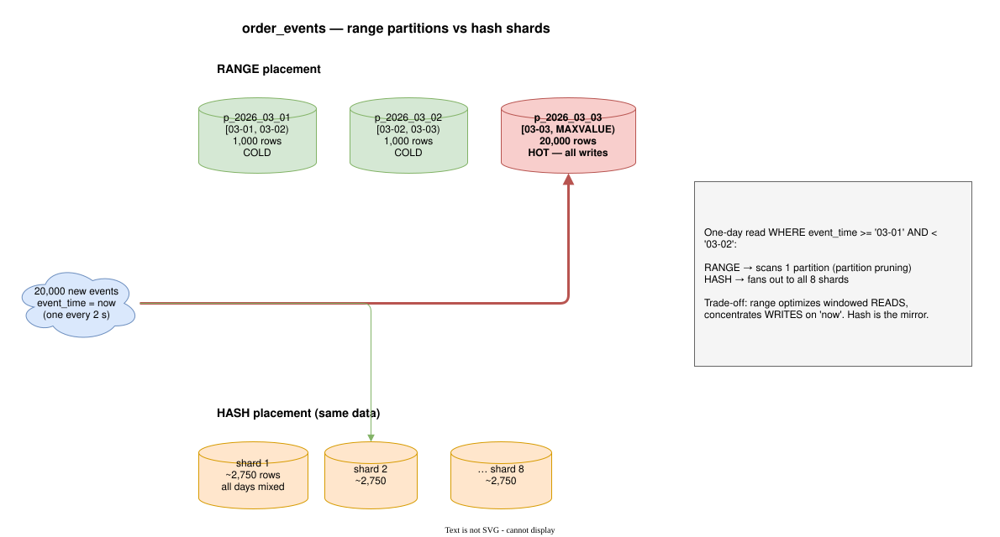

# Module 07 — Partitioning, Range Placement & Time-Series

The fleet platform has two different workloads: fleet operations need fast
tenant lookups (`fleet_id` routing), while high-volume `vehicle_telematics`
pings need time-window reads and cheap retention. Keep the `fleet_id` sharding
design from Labs 3–6; add a second tool rather than replacing it: **native
PostgreSQL table partitioning**. Lab 8 then combines both on one table.

## Where this fits in the labs

1. Labs 1–2 distinguish a logical table from where its rows are stored.
2. Labs 3–5 distribute `fleets` across worker shards and trace a row's location.
3. Lab 6, Tasks 4–6 use the distribution key to reduce distributed query work.
4. [Lab 7, Tasks 1–4](../labs/lab-07-range-partitioning.md#task-1-range-placement-build-a-range-partitioned-table)
   apply the same reasoning to partitions: locate rows, inspect plans, and
   explain which physical tables a query can skip.
5. Lab 8 distributes the partitioned table itself — the two layers stack.
6. The capstone combines these decisions in the dispatch workload.

## Partitioning is not sharding

A partitioned table is a **logical parent** with rows stored in child tables.
An insert into the parent is routed to a child using its partition key and
bounds. A select from the parent reads the relevant children. The parent itself
has no row storage.

| Property | Native partitioning in this lab | Citus distribution in earlier labs |
| --- | --- | --- |
| Physical location | Child tables on the coordinator | Shard tables across workers |
| Routing key | `recorded_at` | `fleet_id` |
| Routing rule | Declared time bounds | Hash token mapped to a shard |
| Read optimization | Skip irrelevant partitions | Skip irrelevant shards |
| Main benefit here | Time-window reads and retention | Scale tenant storage and query work across nodes |
| Does it add machines? | No | Uses registered workers |

A local partition is **not** a worker or a distributed shard. It models range
placement, but does not model network hops, worker failure, or distributed
transactions. In Lab 8, PostgreSQL partitions are combined with Citus
distribution — each partition gets its own set of worker shards.

## Three native partitioning methods

| Method | Routing rule | Fleet use case | Main caution |
| --- | --- | --- | --- |
| `RANGE` | Lower bound included, upper bound excluded | Daily/monthly telematics history | Newest interval receives current writes |
| `LIST` | Explicit sets of values | Region-specific operational data | New values need coverage; popular values can dominate |
| `HASH` | Hash of key, modulus and remainder | Spread rows among local child tables | Still one server; not Citus sharding |

Choose bounds for the workload, not one partition per row or fleet. Too many
partitions add planning and maintenance overhead. Partitioning is not an
automatic performance improvement for every table.

## Follow one ping through the parent

In Lab 7 the parent is `vehicle_telematics`, partitioned by `recorded_at`:

```text
INSERT INTO vehicle_telematics (...)
                |
                v
        route by recorded_at
                |
                +-- [Nov 14, Nov 15)  -> p2026_11_14:  1,000 pings
                +-- [Nov 15, Nov 16)  -> p2026_11_15:  1,000 pings
                +-- [Nov 16, infinity) -> p2026_11_16: 20,000 pings
```

A ping at exactly `2026-11-15 00:00:00` belongs in the **second** partition.
Non-overlapping, half-open intervals avoid ambiguity at midnight. Without a
matching partition or a `DEFAULT` partition, an insert fails. A default partition
can catch gaps but needs monitoring and care when adding new explicit bounds.

The final `MAXVALUE` partition is intentionally simple for this lab. It also
captures all future days: adding another daily partition would overlap it.
Production rotation requires bounded intervals created ahead of time, or an
explicit plan to reorganize a catch-all partition and its existing data.

## Pruning versus indexes

**Partition pruning** uses predicates and partition bounds to avoid scanning
irrelevant children. An **index** finds matching rows inside a retained child.
These are separate optimizations and can be useful together.

```sql
EXPLAIN (COSTS OFF)
SELECT * FROM vehicle_telematics
WHERE recorded_at >= timestamp '2026-11-14'
  AND recorded_at < timestamp '2026-11-15';
```

This literal time window allows PostgreSQL to keep only the Nov 14 partition.
Its scan may still be a sequential scan: pruning worked even without an index.
For other query forms pruning can happen during execution; read the plan rather
than assuming a particular node name.

Compare with `WHERE fleet_id = 1`: a fleet predicate alone does not constrain
`recorded_at`, so all three partitions remain eligible. An index on `fleet_id`
could help within them, but cannot supply a missing time bound. Prefer direct,
type-compatible predicates on the partition key; wrapping it in an expression
can prevent the pruning you expected.

## Prove row location and conservation

Use PostgreSQL's `tableoid` system column to identify the physical child behind
a row returned through the parent:

```sql
SELECT tableoid::regclass AS physical_partition, count(*) AS rows
FROM vehicle_telematics
GROUP BY tableoid
ORDER BY physical_partition::text;
```

The counts sum to 22,000, just as the per-shard counts summed to the logical
`fleets` count in Lab 5. `pg_inherits` describes parent/child membership;
`citus_shards` describes distributed shard placement, not these local
partitions — until Lab 8 distributes the parent, when `citus_shards` starts
listing *per-partition* shards.

## Retention and constraints

Daily partitions make an entire expired interval a lifecycle unit. Operators can
detach a child to keep it as a standalone archive table, or drop an expired child
to remove its data. Both need an explicit retention decision, backup strategy,
and lock planning. Detaching does not delete the child, but immediately changes
which rows are visible through the parent. Lab 7 only plans retention; Lab 8
executes it — and on a distributed parent the drop propagates to every worker,
replacing what would otherwise be a slow, I/O-heavy `DELETE` + `VACUUM`.

A primary or unique constraint on a native partitioned parent must include all
partition-key columns (with additional limitations for expression keys). For
example, a time-partitioned telematics table can use
`(recorded_at, fleet_id, ping_id)`, but this does **not** guarantee that
`ping_id` alone is globally unique. This resembles the shard-key constraint
from Module 04, but applies to a different layer — and when both layers are
present, the PK must satisfy *both*: `(fleet_id, recorded_at, …)`.

## Range reads versus current writes



Time windows can prune range partitions, while a monotonically increasing event
time concentrates writes in the newest interval. Hashing can spread many distinct
keys, but does not preserve time locality or eliminate skew from a dominant key.
In the local Lab 7 table every partition is still on the same coordinator, so
creating more partitions does not add server write capacity.

## Combine partitioning and distribution deliberately

The production shape for fleet telematics is two orthogonal layers:

- **Distribute by `fleet_id`** for worker-level write spread and fleet-local
  operations (hash placement).
- **Partition by `recorded_at`** for pruning and retention (range placement
  inside each shard).

A fleet-plus-time predicate benefits from *both* prunings: the coordinator
routes to one shard, and inside that shard Postgres scans only the partition
covering the window. A time-only report prunes old partitions but still fans
out across the retained partitions' shards. More partitions also mean more
shard objects to manage (8 shards × N partitions). Native partitioned-parent
uniqueness must include the time key; Citus uniqueness also needs the
distribution key.

Lab 7 deliberately keeps `vehicle_telematics` local, making each layer
independently observable. Lab 8 then distributes it, adds a spatial GiST index
that lives *inside* each shard, and drops an expired partition across the
cluster.

**Practice:** complete [Lab 7](../labs/lab-07-range-partitioning.md), then [Lab 8](../labs/lab-08-distributed-timeseries.md).

## Quick check

<quiz>
A `RANGE` partition covers `recorded_at` from `2026-11-14` to `2026-11-15`. Which row lands in it?
- [x] `recorded_at = '2026-11-14'` — the lower bound is included
- [ ] `recorded_at = '2026-11-15'` — the upper bound is included
- [ ] Both
- [ ] Neither

Lower bound included, upper bound excluded. `2026-11-15` belongs to the *next* partition.
</quiz>

<quiz>
What is the key difference between a native Postgres partition and a Citus shard?
- [ ] Partitions use hash routing; shards use range routing
- [ ] Partitions can be pruned; shards cannot
- [x] Partition children live on the same node — they add no machines; shards live across workers
- [ ] There is no difference — the terms are interchangeable

Partitioning splits a table inside one node; sharding distributes slices across nodes. You can combine them deliberately (a distributed table whose partitions are themselves sharded).
</quiz>

<quiz>
A daily-partitioned `vehicle_telematics` table gets a query for `recorded_at >= now() - interval '7 days'`. What does pruning do?
- [ ] Moves old partitions to cheaper storage
- [x] Skips scanning partitions whose bounds can't match the filter
- [ ] Routes the query to a single worker
- [ ] Builds an index on the fly

Partition pruning is the read-side win: irrelevant children are excluded at plan time, like shard pruning on the distributed side.
</quiz>

**Next:** [Module 08 — Capstone](08-capstone.md)
